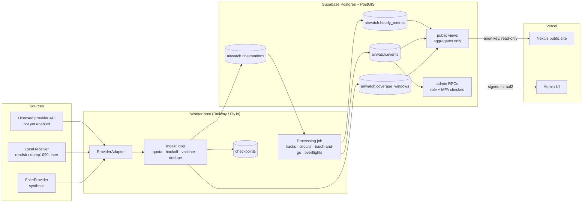
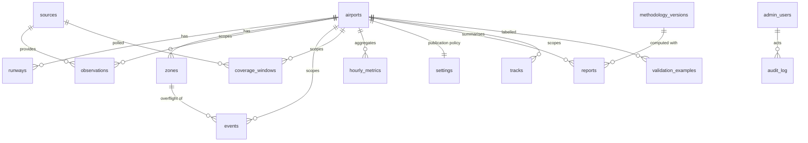

# Erie AirWatch: technical plan (Prompt 0)

This is the Phase 0 deliverable from the PRD: repository layout, system diagram, data model, implementation
order, risks and the open questions that block real-data launch. Everything here is built and runnable with
synthetic data; nothing calls a third-party aviation API.

## Repository

```
erie-airwatch/
├── config/airports/keik.json      single source of truth: airport, runway, pattern, zones
├── worker/                        Python: ingestion, detection, aggregation, CLI
│   ├── airwatch/
│   │   ├── providers/             ProviderAdapter contract, FakeProvider, licensed placeholder, LocalReceiverAdapter
│   │   ├── detection/             runway geometry + versioned detection pipeline
│   │   ├── ingest.py              polling loop: quota, backoff, validation, dedupe, checkpoints, coverage
│   │   ├── jobs.py                idempotent processing: observations → events → hourly aggregates
│   │   ├── aggregate.py           publication policy + public aggregates
│   │   ├── synthetic.py           simulator with ground truth
│   │   ├── evaluate.py            precision / recall scoring
│   │   └── snapshot.py            demo data files for the website
│   ├── tests/                     unit + integration tests (no database needed)
│   └── tests_db/                  PostGIS integration tests (run by scripts/test-db.sh)
├── supabase/
│   ├── migrations/                schema, RLS, public views, admin RPCs
│   ├── rollback/                  one down script per migration
│   ├── seed.sql                   generated from config/airports
│   └── tests/                     schema/RLS tests + local Supabase stub
├── web/                           Next.js 15, TypeScript, Tailwind 4, MapLibre
│   ├── src/app/                   public pages, reports (CSV/PDF), corrections API, admin
│   ├── src/components/            dashboard, map with replay, admin review tools
│   ├── src/lib/                   data loading (demo or Supabase), metrics, formatting
│   └── src/data/demo/             synthetic snapshot produced by the worker
├── scripts/test-db.sh             full database test cycle on local PostGIS
└── docs/                          this plan, ADRs, licence checklist, operations
```

## System



The browser never talks to an aviation provider. The public site reads only views that expose aggregates,
delayed and pseudonymised positions, and published findings. Base tables live in a private schema.

## Data model



Events carry `algorithm_version`, `confidence`, `confidence_label`, the evidence observation IDs, detector
details, `review_status` and an optional reviewer `validation_label`. Event IDs are deterministic (UUIDv5 of
version, kind, track, start, zone), so reprocessing is idempotent and reviewer decisions survive it.

## Implementation order and status

| Phase | Scope | Status |
|---|---|---|
| 0 | Plan, ADRs, licence checklist | Done (this folder) |
| 1 | Next.js site, design system, map, synthetic data, admin auth | Done |
| 2 | Schema, RLS, public views, seed, rollback, schema tests | Done, tested on local PostGIS |
| 3 | Worker: adapter contract, FakeProvider, quota, backoff, checkpoints, coverage, logs | Done |
| 4 | Live map wiring to bounded views, freshness, playback | Done (demo); live path written, needs a Supabase project to exercise |
| 5 | Detection pipeline, confidence, review UI | Done |
| 6 | Labelling workflow, precision/recall, threshold versioning, publication gate | Done for synthetic; real labels need real data |
| 7 | Reports (CSV/PDF), approval, methodology, privacy, corrections, rate limits | Done; load testing, uptime alerts and cost monitoring are deployment tasks (docs/operations.md) |
| 8 | LocalReceiverAdapter contract, second-airport readiness | Contract + parser done; ingestion endpoint not built |

## Key risks

1. **Licensing** is the gating risk. No provider is connected; see `license-checklist.md`.
2. **Sampling rate.** Polling a snapshot API every 60 s gives one point per aircraft per minute. Touch-and-go
   detection needs roughly 2–10 s spacing; at 60 s the detector will mostly emit low-quality findings, which the
   publication policy then hides. Budget for a trace/streaming product or a local receiver.
3. **Low-altitude coverage.** Receivers often lose aircraft below a few hundred feet near KEIK. The simulator
   models this; real coverage must be measured during the 7-day ingestion test.
4. **Go-arounds vs touch-and-goes** are indistinguishable when the go-around is very low. This is disclosed on the
   methodology page and measured in evaluation (14 of 66 simulated go-arounds were labelled likely touch-and-go).
5. **Runway and pattern geometry** in `keik.json` is approximate. Replace with FAA NASR coordinates and confirm the
   pattern direction for each runway in the current Erie SAOP before any real-data analysis.
6. **Public perception.** Counts can be read as accusations. Mitigated by aggregate-only display, no aircraft IDs,
   qualified labels, coverage disclosure and the corrections process.

## Questions that block real-data launch (not the build)

- Which provider and product (snapshot vs trace/stream), at what cost, with written rights for public display and derived metrics?
- The real neighborhood polygons and their public labels.
- Who besides you will hold an admin or reviewer account?
